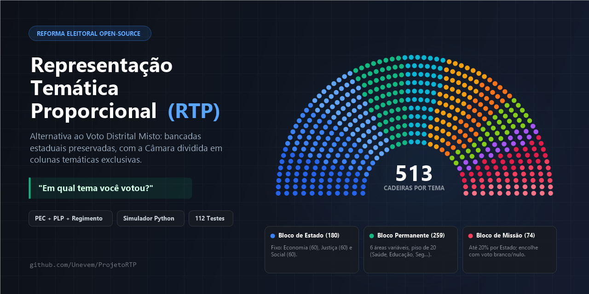

# Representação Temática Proporcional (RTP)

[](https://github.com/Unevem/ProjetoRTP/actions/workflows/tests.yml)
[](https://unevem.gitbook.io/unevem-docs/)
[](https://doi.org/10.5281/zenodo.24522770)
[](https://github.com/Unevem/ProjetoRTP/discussions)
[](simulador/README.md)
[](LICENSE)

**Autor:** Gustavo Elorza Rolim | **Leitura Online (GitBook):** [unevem.gitbook.io/unevem-docs](https://unevem.gitbook.io/unevem-docs/) | **Debates:** [Discussions](https://github.com/Unevem/ProjetoRTP/discussions) | **Licença:** [CC BY 4.0 / MIT](LICENSE) | **Citação:** [CITATION.cff](CITATION.cff)



Proposta aberta de reforma do sistema eleitoral da Câmara dos Deputados do Brasil, construída no formato de projeto colaborativo de código aberto (*open-source*).

> **Objetivo do projeto:** elevar o nível do debate sobre reforma política no Brasil e oferecer uma alternativa concreta, completa e auditável além da falsa dicotomia entre manter a **Lista Aberta atual** ou adotar o **Voto Distrital Misto**. Este projeto não se apresenta como sistema perfeito: todos os custos e limitações do modelo estão documentados abertamente no [Estudo Técnico](docs/ESTUDO_TECNICO_RTP.md).

---

## A ideia em 2 minutos

Hoje, quando você vota para Deputado Federal, precisa garimpar centenas ou milhares de candidatos no seu Estado sem saber em qual comissão da Câmara o eleito vai trabalhar. Depois da eleição, os partidos negociam as comissões a portas fechadas, e os votos excedentes de um candidato podem eleger alguém de pauta completamente diferente da sua. No **Voto Distrital Misto**, cria-se um deputado por região/bairro, mas a desconexão entre o voto e as comissões temáticas continua igual.

Na **Representação Temática Proporcional (RTP)**, em vez de dividir o Estado em distritos geográficos, a Câmara dos Deputados é dividida em **colunas temáticas de trabalho exclusivo**. Cada Estado mantém exatamente a mesma quantidade de deputados de hoje (de 8 a 70), mas o candidato concorre vinculado a uma única área e trabalha exclusivamente nela durante os 4 anos.

As colunas dividem-se em **três blocos**:
1. **Bloco de Estado (tamanho fixo: 180 cadeiras):** três colunas com 60 deputados cada (Economia e Orçamento; Constituição e Justiça; Desenvolvimento Humano e Direitos Sociais, apelidadas no estudo de **economistas, juristas e humanistas**). O voto decide *quem* entra e *de qual Estado*, mas o tamanho nunca muda.
2. **Bloco Permanente (tamanho variável com piso de 20 cadeiras):** seis áreas contínuas (Saúde; Educação e Cultura; Segurança e Defesa; Infraestrutura e Cidades; Agropecuária e Meio Ambiente; Ciência, Tecnologia e Trabalho). Quanto mais o país vota em uma área, maior fica a bancada dela, com proteção mínima de 20 cadeiras por tema.
3. **Bloco de Missão Presidencial (tamanho variável sem piso, teto de até 20% por Estado):** ao registrar candidatura à Presidência, cada candidato é obrigado a escolher 3 temas estratégicos de um catálogo aprovado pelo Congresso. A eleição da Câmara acontece sempre na data do 2º turno (último domingo de outubro), com as colunas dos finalistas presidenciais ativas. Se o eleitor votar em branco ou nulo na escolha do tema de missão, o teto desse bloco encolhe e as vagas voltam automaticamente para as áreas permanentes daquele Estado.

### Como funciona na hora de votar (funil de 3 níveis)
Em qualquer um dos três blocos, você decide o nível de detalhe que quiser:
- **Só o tema:** não teve tempo de pesquisar nomes? Vote apenas no código da área que você quer fortalecer.
- **Tema + Partido:** tem preferência partidária, mas não conhece os candidatos? Vote no tema combinado com a sigla do partido.
- **Candidato específico:** quer escolher a pessoa? O filtro de tema + partido já eliminou a maior parte do ruído antes de você pesquisar (e você ainda pode indicar uma 2ª opção opcional nos Blocos de Estado e Permanente).

### Por que isso muda a conversa do dia a dia?
Hoje, a discussão política começa com *"em qual partido você votou?"* ou *"em quem você votou?"* e trava quase imediatamente em rótulos e ataques pessoais. Na RTP, a pergunta natural passa a ser ***"em qual tema você votou?"***. Duas pessoas com visões diferentes que votaram em Educação, Saúde ou Ciência já começam a conversa em torno de um assunto concreto e de propostas verificáveis, e não apenas de pessoas.

---

## Mapa do Repositório

| Se você quer... | Comece por aqui |
|---|---|
| Ler o **Estudo Técnico completo** (comparação neutra Lista Aberta vs. Distrital Misto vs. RTP, simulações e FAQ) | [docs/ESTUDO_TECNICO_RTP.md](docs/ESTUDO_TECNICO_RTP.md) |
| Ler a **Proposta de Emenda à Constituição (PEC)** com Justificação Formal | [pec/PEC_RTP.md](pec/PEC_RTP.md) |
| Ler o **Projeto de Lei Complementar (PLP)** com equações de apuração | [pec/PLP_RTP.md](pec/PLP_RTP.md) |
| Ler o **Projeto de Resolução da Câmara (PRC)** com regras regimentais internas | [pec/PRC_REGIMENTO_RTP.md](pec/PRC_REGIMENTO_RTP.md) |
| Inspecionar ou rodar o **Simulador Oficial em Python** (112 testes automatizados) | [simulador/README.md](simulador/README.md) |
| Entender a **especificação técnica, decisões e histórico de auditoria (Red Team)** | [spec/SPEC-002-desenho.md](spec/SPEC-002-desenho.md) \| [spec/SPEC-002-tecnico.md](spec/SPEC-002-tecnico.md) \| [decisoes.md](decisoes.md) \| [redteam/RT-01-consolidado.md](redteam/RT-01-consolidado.md) |
| **Criticar, testar ou colaborar** com o projeto | [CONTRIBUTING.md](CONTRIBUTING.md) \| [Discussions](https://github.com/Unevem/ProjetoRTP/discussions) \| [Código de Conduta](CODE_OF_CONDUCT.md) |

---

## Como rodar o simulador localmente

O simulador usa **100% biblioteca padrão do Python 3.12+** (nenhuma dependência externa necessária):

```bash
# 1. Rodar a simulação nacional completa (27 UFs x 12 Colunas) e os 5 testes de estresse
python simulador/rodar_cenario.py

# 2. Rodar toda a suíte de 112 testes automatizados
python -m unittest discover -s simulador/tests
```

<details>
<summary><strong>Ver exemplo de saída real do simulador (27 UFs x 12 Colunas + 5 testes de estresse)</strong></summary>

```text
1. DIMENSIONAMENTO DOS BLOCOS E COLUNAS TEMÁTICAS NACIONAIS
  • Bloco 1 (Núcleo de Estado Fixo) : 180 cadeiras (60 por coluna)
  • Bloco 2 (Colunas Permanentes)   : 259 cadeiras (piso protetor = 20)
  • Bloco 3 (Missões Presidenciais) :  74 cadeiras (teto efetivo U = 74)
  • Total da Câmara dos Deputados   : 513 cadeiras
  Índice de Gallagher (Desproporcionalidade Temática Blocos 2+3): 4.82 p.p.

3. AUDITORIA DAS 6 INVARIANTES CONSTITUCIONAIS
  [✓] Veredito Global Aprovado      : True
  [✓] Soma Total == 513 Cadeiras    : True
  [✓] Pacto Federativo (Art. 45 CF) : True
  [✓] Fechamento Temático Nacional  : True
  [✓] Núcleo de Estado (60 fixas)   : True
  [✓] Pisos Permanentes (>= 20)     : True
  [✓] Tetos Estaduais de Missão     : True

4. RESULTADOS DOS 5 EXPERIMENTOS DE ESTRESSE
  • Voto de Enterro (500k eleitores) : +1 cadeira (Saúde: 80 vs 81; Ciência travada no piso)
  • Puxador +2,5M votos em SP        : +5 cadeiras Segurança (+4 SP, +1 outras UFs; SP fixo em 70)
  • Filas em Seção (400 eleitores)   : STV enxuto (87s) = 1 na fila às 17h (0,38 min) | 3+ opções = 97 na fila
  • Turnout Desigual (82% vs 55%)    : Desvio nas bancadas das UFs = 0 | Deslocamento entre colunas = 2
  • 2% Urnas Remotas Amazônia Legal  : 511/513 cadeiras (99,6%) já definidas antes dos últimos 2%
```

</details>

---

## Help Needed (Onde Mais Precisamos de Ajuda)

Este projeto nasceu de forma independente, sem estrutura partidária nem contatos políticos. Toda crítica fundamentada, teste independente ou melhoria é bem-vinda. Abaixo estão as frentes abertas por ordem de prioridade:

### 1. Revisão Matemática e Calibração com Dados Reais (Prioridade Máxima)
> **Nota de transparência do autor:** de todas as partes deste projeto, a **modelagem matemática** (alocação biproporcional de Balinski-Demange, método de Sainte-Laguë, coluna de folga de Gaffke-Pukelsheim, Bellman-Ford e voto único transferível simplificado) é, de longe, a parte em que menos confio na minha própria conferência individual. Os 112 testes do simulador comprovam consistência interna em dados sintéticos, mas precisamos de olhos independentes para validar a teoria e os casos extremos.

- **Auditoria no software BAZI:** exportar nossas matrizes e confrontar divisores e resultados no software acadêmico [BAZI](https://www.math.uni-augsburg.de/htdocs/emeriti/pukelsheim/bazi/) (Universidade de Augsburg).
- **Calibração empírica com dados do TSE 2022:** rodar o simulador com dados reais de votação e candidaturas das eleições de 2022 para medir o comportamento real de partidos pequenos, médios e grandes em comparação com a Lista Aberta e o Distrital Misto.
- **Onde enviar:** `contribuicoes/ajuda-tecnica/<seu-nome>/` (veja [CONTRIBUTING.md](CONTRIBUTING.md)).

### 2. Site Estático Interativo no GitHub Pages (Ajuda Técnica / Design)
Gostaria muito de disponibilizar um **site simples e interativo** (hospedado gratuitamente via GitHub Pages) onde qualquer cidadão possa ler o resumo visual da ideia, mexer nos votos simulados por tema/Estado e ver na hora como as cadeiras mudam. Ainda não montei nem hospedei essa interface. Se você trabalha com front-end, visualização de dados ou UX e quiser construir um protótipo ou ajudar a colocar no ar, entre em contato ou abra um Pull Request em `contribuicoes/ajuda-design/<seu-nome>/` ou `contribuicoes/ajuda-tecnica/<seu-nome>/`.

### 3. Revisão Jurídica, Constitucional e Regimental
- Pareceres críticos sobre a constitucionalidade do efeito redutor do voto em branco/nulo na 1ª tela do Bloco de Missão, a trava de aceite presidencial na migração pós-1º turno, a suplência macrorregional e a conformidade legística (LC nº 95/1998).
- Debate aberto sobre manter **Agropecuária e Meio Ambiente** em uma única coluna ou separá-los (conforme nota do autor no Estudo Técnico).
- **Onde enviar:** `contribuicoes/ajuda-juridica/<seu-nome>/`.

### 4. Comunicação, Vídeos Explicativos e Divulgação
- Gravar vídeos curtos (YouTube, Reels, TikTok), escrever threads explicativas ou criar infográficos comparando Lista Aberta, Distrital Misto e RTP de forma honesta e acessível.
- Preparar e divulgar resumos para consulta pública (como o portal **e-Cidadania** do Senado Federal).
- Montamos um **roteiro com os pontos recomendados** para quem quiser gravar um vídeo ou explicar a proposta sem se perder na matemática: veja [contribuicoes/ajuda-comunicacao/ROTEIRO_VIDEOS_E_DIVULGACAO.md](contribuicoes/ajuda-comunicacao/ROTEIRO_VIDEOS_E_DIVULGACAO.md).
